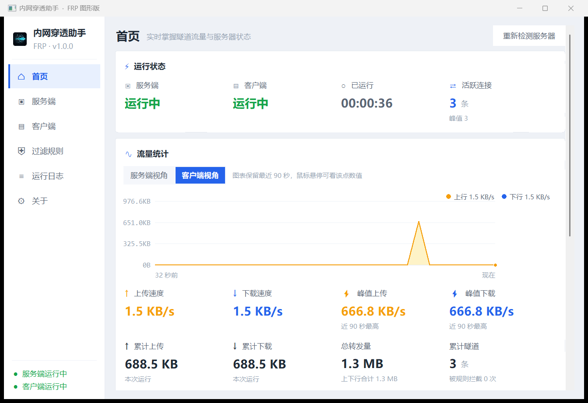
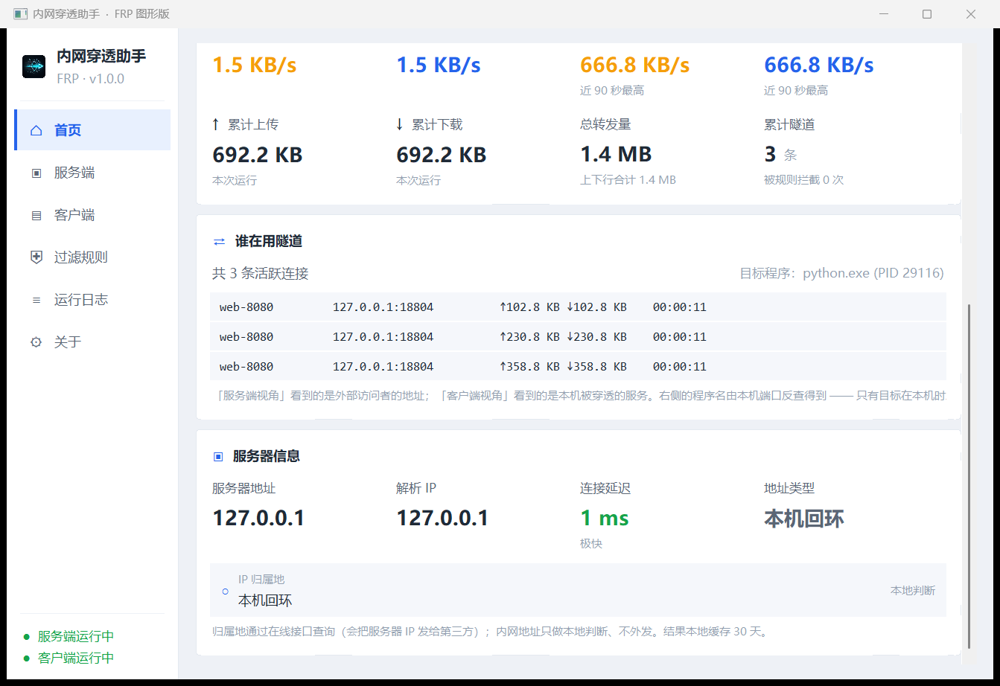
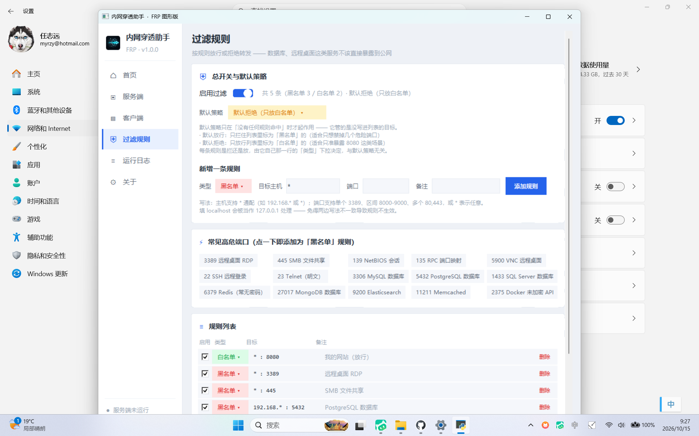

# aio-frp-python

基于 Python 异步 IO 实现的 frp 内网穿透，带 **token 鉴权 + TLS 加密 + 限流 + 运行统计**，
并支持 **多客户端**、**token 轮换（新旧并存过渡期）**、**证书自动续期**、
**UDP 转发**、**P2P 打洞探测** 与 **传输层稳定性优化**；另提供**图形界面版**（单文件 exe，双击即用）。

> **作者**：jsdczd任志远
> **邮箱**：mailrzy@126.com
> **主页**：<https://github.com/zhiyuan-cyber>
>
> 作者信息集中维护在 `about.py`，界面署名、「关于」对话框、
> exe 文件属性（右键 → 属性 → 详细信息）与命令行 `--about` 全部读同一份，改一处即全生效。

## 环境要求

| 项目 | 要求 | 说明 |
| --- | --- | --- |
| **Python** | **3.10 及以上**（实测 3.13 / 3.14） | 界面用标准库 `tkinter`，不需要额外 GUI 库 |
| **操作系统** | **Windows** | 图形界面与托盘用了 Win32 API；纯命令行模式在 Linux/macOS 上理论可用，但未做实测 |
| `cryptography` | 仅证书相关需要 | `pip install cryptography`。只在**生成/续期证书**时用到 |
| `pyinstaller` | 仅打包 exe 需要 | `pip install pyinstaller`。只想跑起来的话不需要 |

一次装齐（要打包或要证书自动续期时）：`pip install -r requirements.txt`

**关键一点：本项目几乎没有第三方依赖。**
界面（`ui_kit.py` 纯 Canvas 自绘）、托盘（`tray.py` ctypes 直调 Win32）、
网络（`asyncio` + `ssl`）、日志与统计全部只用**标准库** ——
所以除了"生成证书"这一步，**不装任何第三方库也能跑起来**。

### 从源码运行

```bash
git clone <本仓库地址>
cd aio-frp-python

python gen_cert.py        # ① 生成自签证书（首次必做，需要 cryptography）
python quickstart.py      # ② 一键生成 token 与配置模板（可选，推荐）
python gui.py             # ③ 图形界面版（最省事）
```

不想用界面的话，命令行模式同样简单：

```bash
python frps.py --help     # 服务端（跑在有公网 IP 的机器上）
python frpc.py --help     # 客户端（跑在内网机器上）
```

跑测试（验证环境是否正常）：

```bash
python test_e2e.py        # 端到端：穿透 / 统计 / 鉴权 / 限流
python test_rules.py      # 过滤规则
```

## 文件说明

| 文件 | 作用 |
|---|---|
| `protocol.py` | **两端共用的协议层**：协议常量、鉴权握手、UDP/P2P 帧、TLS 上下文、统计、数据泵、看门狗 |
| `about.py` | **程序与作者信息（单一来源）**：姓名 / 邮箱 / 主页 / 版本，界面与打包脚本都从这里取 |
| `gui.py` | **图形界面版**：侧边栏分模块（首页 / 服务端 / 客户端 / 过滤规则 / 日志 / 关于） |
| `ui_kit.py` | 界面组件：圆角卡片、流量图表、导航项、开关 —— 全部 Canvas 自绘，零第三方依赖 |
| `tray.py` | **系统托盘**：最小化后台常驻 + 托盘图标自动常显（ctypes 直调 Win32 `Shell_NotifyIcon`，同样零依赖） |
| `rules.py` | **转发过滤规则**：每条规则自带类型（黑名单=拒绝 / 白名单=放行）+ 默认策略兜底，按「目标主机 + 端口」限制哪些内网服务不许被穿透 |
| `mobile_api.py` | **手机控制接口**：局域网 HTTP + `X-Frp-Token` 鉴权，供鸿蒙 App 读状态/日志/规则并远程启停 |
| `harmonyos/` | **鸿蒙手机端工程**（ArkTS 原生应用）：远程控制台，五个标签页 —— 需自行用 DevEco Studio 构建 `.hap` |
| `netinfo.py` | **服务器信息探测**：DNS 解析、IP 归属地（在线查询 + 本地缓存）、TCP 延迟、目标端口反查进程名 |
| `build_exe.py` | 把 `gui.py` 打包成单文件 exe（自动写入图标与作者信息） |
| `make_icon.py` | 从 `assets/icon-source.jpg` 生成程序图标（换图标时才需要跑） |
| `config.py` | **配置文件加载**：TOML 读取、分段拉平、命令行覆盖逻辑 |
| `frps.py` | 服务端：跑在有公网 IP 的机器上 |
| `frpc.py` | 客户端：跑在需要被访问的内网机器上 |
| `quickstart.py` | 一键生成证书 + token + 配置模板（第一次上手用） |
| `cert_renew.py` | 证书自动续期（用保留的 CA 私钥重签服务端证书） |
| `gen_cert.py` | 生成自签 CA 与服务端证书（需要 `cryptography`） |
| `test_e2e.py` | 端到端测试（TLS + 鉴权 + 限流 + 统计） |
| `test_multiclient.py` | 多客户端 / token 轮换 / 证书自动续期 测试 |
| `test_reconnect.py` | 服务端重启后客户端自愈重连测试 |
| `test_udp.py` | UDP 转发测试（回声、会话复用、多来源、超时回收） |
| `test_p2p.py` | P2P 打洞测试（成功路径、黑洞回退、限时、开关） |
| `test_logging.py` | 日志输出测试（多模块落盘、无重复、7 天轮转策略、级别识别） |
| `test_mobile_api.py` | 手机控制接口测试（鉴权、11 条路由、规则增删改类型、启停回调、边界） |
| `test_rules.py` | 过滤规则测试（每条规则的类型、拒绝优先、默认策略、旧数据迁移、存盘往返） |
| `test_rules_gui.py` | 规则页界面测试（真起界面：下拉切换 → 落盘 → 判定即生效，试算框） |
| `check_harmonyos.py` | 鸿蒙工程静态校验（结构、JSON5、资源引用、导入符号、接口字段一致性） |
| `certs/` | 证书目录（`ca.crt` / `ca.key` / `server.crt` / `server.key`）—— **不进版本库**，首次运行自动生成 |
| `assets/` | 图标资源：`icon.ico`（exe/桌面/任务栏）、`icon.png`、`icon-1024.png` 母版、`icon-source.jpg` 原图 |
| `screenshots/` | 界面与图标截图（README 配图） |
| `.gitignore` | 已配置好：凭据、产物、缓存一律不入库 |

> **关于凭据**：本仓库**不包含任何证书或 token**（`certs/`、`tokens.txt` 已在 `.gitignore` 中排除）。
> 克隆后首次运行会自动生成一套属于你自己的；若要跑测试，先执行一次
> `python gen_cert.py` 生成 `certs/` 即可。
> 千万不要把自己的 `certs/*.key` 或 `tokens.txt` 提交上来 —— 那等于公开你的钥匙。

## 工作原理（一句话）

每个内网客户端在服务端**注册一个唯一名字 + 一个专属对外端口**；
外部用户连到某个端口，服务端就通知对应客户端开一条隧道过来，
之后数据在「用户 ⇄ 服务端 ⇄ 内网客户端 ⇄ 本机服务」之间自动转发。

```
用户A ──▶ frps:9001 ──隧道──▶ frpc[web]  ──▶ 内网 web:8080
用户B ──▶ frps:9001/udp ──UDP承载隧道──▶ frpc[rdp] ──▶ 内网 rdp:3389 (UDP)
             frps:8800 ◀──控制/心跳（多客户端多路复用）── frpc ×N
             （两段都走 TLS，且都需通过 token 鉴权）
```

> **对外端口按客户端分配**：客户端在配置里声明 `remote_port`（TCP）与可选的
> `udp_port`（UDP），服务端据此动态开启监听。多个客户端互不干扰。
> TCP 与 UDP 是**独立的名字空间**，同一个端口号可以同时开 TCP 和 UDP。

---

## 最简单的用法：图形界面版（推荐给不熟悉命令行的使用者）

不想记参数？直接双击一个 exe 就行。左侧分模块导航，右侧是圆角卡片式内容：



### 首页能看懂什么

- **运行状态**：服务端 / 客户端是否在跑、已运行多久、当前活跃连接数与历史峰值
- **流量统计**：上行（橙）/ 下行（蓝）双线实时图表，保留最近 90 秒，鼠标悬停看具体数值；
  另有当前速率、**近 90 秒峰值速率**、累计上传 / 下载、总转发量、累计隧道数
  （可在「服务端视角 / 客户端视角」之间切换，各自独立统计）
- **谁在用隧道**：实时列出每一条正在转发的连接 —— 代理名、对端地址、
  这条连接已转发多少（↑上行 / ↓下行）、持续了多久。
  在**客户端视角**下还会反查目标端口对应的**进程名**（如 `python.exe (PID 18300)`），
  直接回答"到底哪个程序在用这条隧道"。
  > 说明：进程名是靠本机 TCP 表反查的，所以只有目标在**本机**时才查得到；
  > 目标是局域网另一台机器时会标注「非本机，看不到进程」。

  

- **服务器信息**：解析出的 IP、地址类型（公网 / 内网）、TCP 连接延迟（含快慢分档）、
  **IP 归属地**（如「江苏省南京市 电信」，带本地缓存，内网地址不外发）

内容多的时候**直接滚鼠标滚轮**即可（不用去拖右侧滚动条）。

### 最小化到托盘常驻

穿透是"挂着一直跑"的东西，不适合跟着窗口一起关。所以：

- 点**最小化**或**关闭窗口**时，如果还有服务在跑，窗口会收进系统托盘，
  **后台继续转发**，并弹一个气泡提示；
- **双击托盘图标**唤回窗口；**右键**托盘图标是菜单（显示主界面 / 退出程序）；
- 如果当前什么都没跑，关闭窗口就是**真的退出**，不会留下看不见的进程。

> **托盘图标会自动"常显"**，不会藏在 Win11 的 `^` 折叠区里 ——
> 程序在图标出现后会自动把自己的通知区域设置改为常显
> （微软没给公开 API，走的是注册表 `HKCU\Control Panel\NotifyIconSettings`；
> 实测写入即时生效，无需重启 explorer，也不用重新添加图标）。
> 如果你就是想让它待折叠区、手动改了回去，程序会尊重你的选择、不再覆盖。

### 运行日志

程序把**所有模块**的关键事件写进 **`logs/app.log`**（在 exe 旁边）。

**保留策略：按天轮转，保留最近 7 天。** 每天 0 点自动切一份，旧的改名为
`app.log.2026-10-14`，超过 7 天的自动删除；即使程序跨天不重启也会照常切。
所以任何时候打开 `logs/` 都能翻到最近 7 天的完整记录。
（启动时还会主动扫一遍，把超过 7 天的旧文件清掉 —— 程序停几天再开也一样。）

exe 是窗口程序、没有控制台，所以出问题时先看这个文件 —— "服务起不来"
"隧道断了""托盘图标没显示"之类的线索都在里面。源码运行时同样会写，
并且日志还会同时打印到终端。

**界面里的「运行日志」页**：

| 功能 | 说明 |
| --- | --- |
| 历史回填 | 打开页面即把最近 7 天的日志读进来，不是空白页 |
| 级别筛选 | 下拉选 DEBUG / INFO / WARNING / ERROR，只看关心的级别 |
| 关键字搜索 | 输入后回车，按内容过滤（如输入 `隧道`） |
| 重新载入 | 重新从磁盘读一次，拿到别的进程写入的记录 |
| 导出… | 把最近 7 天日志另存一份，便于发给别人排查 |
| 打开日志目录 | 在资源管理器里定位到 `logs/` |
| 自动滚动 | 关掉后可以安心往上翻，新日志不会把视图拽走 |

> 注意「清空」只清**界面显示**，不会删磁盘上的日志文件 ——
> 日志是排查问题的依据，误点一下删掉会很难受。要删请用「打开日志目录」。

日志采用统一的 handler 配置（`protocol.install_logging`）：
所有 logger 保持 `propagate=True`，handler 只挂在 root 上，
因此**每条记录只输出一次**（既不重复、也不漏），
且新增模块只要把名字加进 `protocol.PROJECT_LOGGERS` 就能自动落盘与上屏。

### 手机控制（鸿蒙 App）

程序内置一个**只走局域网**的轻量控制接口，配一个鸿蒙手机 App，
就能在手机上**看状态/流量、翻日志、远程启停、改过滤规则**。

先说清楚一件事（也是唯一能落地的做法）：

| 事实 | 说明 |
| --- | --- |
| **鸿蒙不支持 Python 应用开发** | HarmonyOS NEXT 官方应用语言只有 **ArkTS** 与 **C/C++（NAPI）**。Python 在鸿蒙上只用于构建脚本，不是应用开发语言。 |
| **不存在 Python → .hap 的工具链** | 所谓"把 `frps.py` 编译成鸿蒙应用"在技术上不成立。 |
| **本项目的界面是 tkinter + Win32** | 托盘、DPI 感知走 `ctypes` 直调 Win32，鸿蒙上没有对应 API，必须整体重写。 |

所以本方案是**分工**：穿透引擎继续跑在电脑上（一行不改），
手机 App 作为**远程控制台**：

```
┌─────────────────┐   HTTP / JSON  +  X-Frp-Token   ┌──────────────────┐
│  鸿蒙手机 App    │ ─────────────────────────────▶ │  电脑上的         │
│  （ArkTS 工程）  │ ◀───────────────────────────── │  内网穿透助手     │
└─────────────────┘   状态/流量/连接/日志/规则       └──────────────────┘
                                                          │
                                                    真正的穿透隧道
```

**怎么用**：

1. 电脑端正常启动（手机接口默认就开，监听 `0.0.0.0:8899`，被占用会自动顺延）；
2. 打开 **「关于」页 → 手机控制（鸿蒙 App）**，能看到**接口地址**与**访问令牌**
   （`http://192.168.1.100:8899`、令牌形如 `164023-a1b2c3d4`）；
3. 手机与电脑连**同一个 WiFi**，把 IP / 端口 / 令牌填进手机 App 的「设置」页，点「保存并测试连接」。

**电脑端相关参数**：

| 参数 | 默认 | 说明 |
| --- | --- | --- |
| `--mobile-api-port 8899` | 8899 | 手机控制端口，被占用自动往后顺延 |
| `--mobile-api-localhost` | 关 | 只允许本机访问（更安全，手机就连不上） |
| `--mobile-api-lan` | 开 | 允许局域网访问（默认行为，显式写出来更明白） |
| `--no-mobile-api` | 关 | 完全关闭这个接口 |

**安全**：令牌每次启动随机生成，用 `hmac.compare_digest` 比对（防时序攻击）；
接口能力仅限"读状态/日志/规则 + 启停 + 改规则"，**不提供文件读写、不执行任意命令**；
**不要把 8899 映射到公网**。

**手机 App 工程**在 `harmonyos/`（ArkTS 原生应用，五个标签页）。
鸿蒙默认禁止明文 HTTP，需要在工程里配 `network_config.json` 放行 ——
细节见 [`harmonyos/README.md`](harmonyos/README.md)。

> ⚠️ **`harmonyos/` 工程需要在你自己的机器上用 DevEco Studio 构建成 `.hap`**：
> 生成它的机器没有装 DevEco Studio / 鸿蒙 SDK / hvigor / ohpm，
> 无法产出安装包。用 DevEco Studio 5.0+（建议 6.0.2+，对应 HarmonyOS 6）
> 打开该目录 → 自动生成签名 → 连真机 ▶ Run 即可。详见该目录的 README。

### 字体清晰度

程序会声明 **DPI 感知**并按显示器实际缩放渲染。这一点很关键：
不声明的话 Windows 会把整个界面按 125%/150% **位图拉伸**，字就会发虚
（实测本机 1920×1200 @125%，未声明时画面由系统放大，文字明显发糊）。
现在按原生 DPI 绘制，缩放到多少都清晰。

### 过滤规则：不让危险服务被穿透出去

内网里的数据库、远程桌面、SMB 共享本就不该暴露到公网。规则页支持：

- **每条规则自带类型**，在规则列表里逐条选 —— 一目了然，黑白可混排：

  | 类型 | 含义 |
  | --- | --- |
  | **黑名单**（红色） | 命中即**拒绝** |
  | **白名单**（绿色） | 命中即**放行** |

- **默认策略**：只在这条目标"没命中任何规则"时兜底
  - **默认放行**：只拦住标为黑名单的（适合只想禁掉几个危险端口）
  - **默认拒绝**：只放行标为白名单的（适合这台机器只准暴露 8080）
- **判定顺序：拒绝优先** —— 命中黑名单就拒绝；否则命中白名单就放行；都没命中按默认策略。
  （刻意不做"谁在前谁赢"：拖动一下顺序结果就变，太难预测。）
- 主机支持 `*` 通配（`192.168.*`、`*`），端口支持单个 `3389`、区间 `8000-9000`、多个 `80,443`、`*`
- 内置 **15 个常见高危端口**，点一下即加为**黑名单**（RDP / SMB / Redis / MySQL / Docker API …）
- 规则页底部有**试算框**：填 `主机 + 端口` 点"试一下"，立刻看到会被放行还是拒绝、以及原因
- 规则写进 `rules.json`，**改动对之后新建的隧道立即生效**，已建立的连接不会被半路掐断
- 客户端页会实时显示"当前目标是否会被拦截"，启动前也会再提醒一次
- 旧版 `rules.json` 会自动升级（按当时的模式给每条规则补上类型），**升级前后判定结果一致**



> 顺带修掉一个旧版的坑：以前"黑名单/白名单"是**全局模式**，
> 在**白名单模式下点"常见高危端口"**，加进去的规则会变成"**放行**这些高危端口" —— 与本意相反。
> 现在快捷添加固定为黑名单，不会再反过来。

### 拿到 exe

两种途径，任选其一：

**A. 直接用打包好的**（仓库里已带，克隆下来即可用）

```
release/内网穿透助手.exe
```

> 单文件、自包含，拷到任何 Windows 机器上双击即可，无需安装 Python。

**B. 自己打包**（约 2 分钟）

```bash
pip install -r requirements.txt   # 打包需要 pyinstaller + cryptography
python build_exe.py
# 产物：dist/内网穿透助手.exe
```

> 打包环境需要有 `pyinstaller`、`cryptography` 和带 `tkinter` 的完整版 Python。
> 打包出的 exe 是**自包含**的 —— 拷到任何 Windows 机器上双击即可，对方无需装 Python。

### 怎么用（四步）

**第 1 步 · 公网机器上开服务端**

双击 exe → 切到「服务端」页 → 填控制端口（默认 8800，不用改）→ 点 **启动服务端**。
首次启动会自动生成自签证书和随机 token，日志里能看到：

```
证书已生成：certs/（含 ca.crt，客户端需要它）
已生成随机 token → tokens.txt
启动服务端：监听 0.0.0.0:8800
控制端口监听 0.0.0.0:8800 [TLS]（供内网客户端连接）
```

然后点 **导出连接包（给客户端）**，得到一个 `frp-连接包.zip`。
这个包里是客户端需要的两样东西：`ca.crt`（校验服务端身份）和 `tokens.txt`（共享密钥）。

**第 2 步 · 把连接包拷到内网机器**

U 盘、微信、SCP 都行。**注意：连接包里含密钥，别发到公开场合。**

**第 3 步 · 内网机器上开客户端**

拷一份 exe 过去双击 → 切到「客户端」页 → 点 **导入连接包** 选择那个 zip →
再填三个框：

| 填什么 | 例子 |
|---|---|
| 服务器地址 | 你公网机器的 IP，如 `110.110.110.1` |
| 本机服务端口 | 要暴露的服务，如 RDP 是 `3389`、网站是 `8080` |
| 对外端口 | 希望外部用哪个端口访问，如 `9001` |

需要转发 UDP（如 RDP 的 UDP 通道）时，再填一个 **UDP 对外端口**。
→ 点 **启动客户端**。

**第 4 步 · 外部访问**

在任意能连到公网机器的设备上：

```
RDP：  110.110.110.1:9001
网页： http://110.110.110.1:9001
```

### 界面上能看到什么

- **实时日志**：滚动显示连接、鉴权、隧道建立、统计摘要，出错时红色高亮，一眼看出问题；
  打开页面即回填最近 7 天历史，支持级别筛选、关键字搜索、导出。
- **运行状态**：底部左右各一个状态灯，绿色 = 运行中。
- **一键启停**：按钮文字会在「启动」和「停止」之间切换，点停止后线程会优雅收尾。

### 出问题时先跑自检

exe 带一个隐藏的自检开关，会在临时目录里起一套完整环境（服务端 + 客户端 + 一个内网回声服务），
跑一次真实的 TLS 握手、鉴权、隧道建立与数据转发，几秒后给出结论：

```bash
内网穿透助手.exe --selftest
# 正常输出：外部发出 b'hello-frp' → 收到 b'ECHO:hello-frp'
#            [selftest] 流量统计：上行 14 B 下行 9 B 合计 23 B
#            SELFTEST: PASS
```

看到 `SELFTEST: PASS` 就说明程序本体（证书、TLS、鉴权、转发）是好的，
问题一定出在网络环境或参数填写上（端口被占、防火墙、地址填错）。
它还会顺带核对**方向性流量统计**：上行 + 下行 必须等于总转发量，不等就判失败。

### 作者信息在哪里能看到

| 位置 | 怎么看 |
|---|---|
| 「关于」页 | 侧边栏点**关于**，姓名 / 邮箱 / 主页都在，邮箱与主页是**可点链接** |
| 侧边栏底部 | 常驻显示服务端 / 客户端的运行状态 |
| exe 文件属性 | 右键 exe → **属性 → 详细信息**（公司、版权、备注里都有） |
| 命令行 | `内网穿透助手.exe --about` 弹出关于窗口；`frps.py --about` / `frpc.py --about` 直接打印 |

改作者信息只需编辑 `about.py` 一处，界面与打包产物会在下次 `python build_exe.py` 时全部更新。

### 程序图标

图标取自 `assets/`，同一份资源用在三个地方：**桌面/资源管理器**（exe 内嵌）、
**任务栏**（运行期窗口图标）、**标题栏**。各尺寸都做了适配：


想换成自己的图标：

```bash
# 1) 把新图存成 assets/icon-source.jpg
python make_icon.py     # 自动检测圆角边界 → 生成多尺寸 ico + png
python build_exe.py     # 重新打包，图标与作者信息一起写进 exe
```

> `make_icon.py` 会自动从图里找出徽标的描边位置来推算圆角半径并抠成透明背景，
> 因此换一张构图类似的图不用手改参数。生成过程中的 `assets/_preview.png`
> （各尺寸预览）已被 `.gitignore` 排除，不会进版本库。

### 界面版和命令行版的关系

两者**用的是同一套核心代码**（`frps.py` / `frpc.py`），能力完全一致：

| | 图形界面版 | 命令行 / 配置文件版 |
|---|---|---|
| 适合谁 | 偶尔用一次、不想记参数 | 常驻服务器、写进开机自启 |
| 上手成本 | 双击 + 填 3 个框 | 记 20 个参数或写 TOML |
| 高级调优 | 用默认值 | 全部可调（限流、会话数、打洞超时…） |
| 部署方式 | 手动双击 | 可注册为 Windows 服务 / systemd |

> 想常驻运行、开机自启、精细调参 → 用下面两节的配置文件模式。
> 只想临时把内网某个端口开出去 → 用 exe 就够了。

---

## 快速开始（推荐：配置文件模式）

### 第 0 步：一键生成素材

```shell
pip install cryptography          # 只在生成证书时需要
python quickstart.py server       # 生成 certs/ + tokens.txt + server.toml
python quickstart.py client       # 生成 client.toml
```

它会自动：生成证书（含自动续期要用的 `ca.key`）、生成一个**随机 token** 写进
`tokens.txt`、写出带注释的配置模板。**已存在的文件不会覆盖**，可以反复运行。

### 第 1 步：改两处配置

打开 `server.toml`，把 `cert_host` 改成你的公网 IP/域名；
打开 `client.toml`，改 `serve_host`（服务器地址）、`local_port`（本机服务端口）、
`remote_port`（对外端口）、`proxy_name`（客户端名字）。

### 第 2 步：各一条命令启动

```shell
# 公网机器
python frps.py -c server.toml

# 内网机器
python frpc.py -c client.toml
```

就这样。配置里默认已经开好 TLS、token 鉴权、限流和证书自动续期。

> **临时想改某一项**？命令行显式给出的值会**覆盖**配置文件：
> ```shell
> python frpc.py -c client.toml --local_port 3306
> ```

---

## 快速开始（纯命令行模式，不用配置文件）

如果你更喜欢把参数写在命令行上，两种方式**完全等价**、可混用。

<details>
<summary>展开查看完整命令行写法</summary>

### 第 1 步：生成证书

```shell
pip install cryptography
python gen_cert.py --host 你的服务器IP --host localhost --out certs
```

生成 **四个** 文件：

| 文件 | 给谁用 |
|---|---|
| `ca.crt` | 客户端 `--ca_file`（校验服务端身份） |
| `ca.key` | 服务端 `--ca_key_file`（**自动续期**时要重签证书，必须保留） |
| `server.crt` | 服务端 `--cert_file` |
| `server.key` | 服务端 `--key_file`（私钥，**务必保密**，不要提交到仓库） |

> ⚠️ 默认 SAN 同时覆盖 `localhost` 与 `127.0.0.1`。
> 如果你的服务端用的是别的域名/IP，务必在 `--host` 里写上，否则客户端会报
> `certificate is not valid for 'xxx'`（证书主机名不匹配）。

### 第 2 步：启动服务端（公网机器）

```shell
python frps.py \
  --serve_host 0.0.0.0 --serve_port 8800 \
  --user_host  0.0.0.0 \
  --token_file tokens.txt \
  --cert_file certs/server.crt --key_file certs/server.key \
  --ca_cert_file certs/ca.crt --ca_key_file certs/ca.key \
  --cert_host 你的服务器IP --cert_host localhost \
  --cert_renew_days 30
```

`tokens.txt` 每行一个密钥，`#` 开头为注释，**首行为主 token**：

```
new-token-2026      # 主 token
old-token-2025      # 过渡期保留的旧 token
```

服务端会**每 5 秒检查一次该文件**，改动后立即生效，无需重启。

### 第 3 步：启动客户端（内网机器）


```shell
python frpc.py \
  --serve_host 你的服务器IP --serve_port 8800 \
  --local_host 127.0.0.1 --local_port 3389 \
  --proxy_name rdp --remote_port 9001 \
  --token_file tokens.txt \
  --ca_file certs/ca.crt
```

每个客户端 `--proxy_name` 必须唯一，`--remote_port` 是自己对外暴露的端口。

### 第 4 步：访问

外部用户直接连服务端的 `9001` 端口（走 TLS），就等于连到了内网机器的 `3389`：

```
外部用户 ──▶ 服务端IP:9001 ⇄ 内网机器:3389
```

---

## 三大进阶能力

### 一、多客户端

- 每个客户端用 `--proxy_name` 声明身份、`--remote_port` 声明对外端口。
- 服务端维护 **名字 → 会话/端口** 的路由表，各自独立、互不串台。
- 同一个名字重连时**复用**已有端口，不会出现短暂的服务中断。
- 名字或端口冲突/缺失会被服务端拒绝接入，并在日志里说明原因。

### 二、token 轮换（新旧并存过渡期）

轮换的完整流程（**全程无需中断服务**）：

1. 服务端 `tokens.txt` 里同时保留 新、旧 两个 token（新在前）。
2. 各客户端陆续切到新 token（改自己的 `--token_file` / `--token`）。
3. 确认所有客户端都已换完，再把旧 token 从 `tokens.txt` 删掉。

服务端每 5 秒热重载 `tokens.txt`，因此第 1→2 步可以**平滑过渡**，
不会出现"改完配置就全掉线"的窗口期。

> 安全细节：校验时会遍历**所有**候选 token 并做恒定时间比较（`hmac.compare_digest`），
> 且**不会提前返回**——避免通过响应时间差异推断出轮换状态。

### 三、证书自动续期

- **启动时**检查一次证书剩余有效期，若少于 `--cert_renew_days`（默认 30 天）就立即续期。
- **运行中**每 24 小时检查一次，同样临期即续。
- 续期用保留的 `ca.key` 对原 CA 重签服务端证书，因此**客户端无需更换 `ca.crt`**。
- 续期后**自动热加载**：重建 SSLContext 并重启用户端口监听，新连接立即用上新证书。

> 为什么续期后要"重启监听口"而不是只改属性？因为 asyncio 在
> `Server._start_serving()` 时就把 ssl_context 冻结进了每个 socket 的协议工厂，
> 之后再改 `server._ssl_context` **不生效**（详见代码注释）。

---

## UDP 转发

内网服务如果有 UDP 端口（DNS 53、游戏 27015、RDP 3389 的 UDP 通道等），
客户端只要多声明一个 `udp_port` 就能一并穿透：

```toml
# client.toml
remote_port = 3389      # 对外 TCP
udp_port = 3389         # 对外 UDP（可与 TCP 同号）
local_port = 3389       # 内网 TCP
udp_local_port = 3389   # 内网 UDP（默认与 local_port 相同）
```

服务端会自动在 UDP 3389 上开始监听。外部用户对该端口发 UDP 包，
就会被转发到内网机器的 UDP 3389。

### 为什么 UDP 不能照搬 TCP 的做法？

TCP 是"连接"：每个外部用户一条连接，天然一一对应，所以"一连接一隧道"很自然。
UDP 是"数据报"：没有连接，同一个用户会连续发很多包。如果**每个包都开一条隧道**：
1. 开销爆炸（每包一次握手 + 建连）；
2. **会话被打散** —— 内网 UDP 服务会看到"每个包来自不同源端口"，
   像 DNS / RDP / 游戏这类有会话状态的服务立刻就不认了。

### 本项目的做法：**一条隧道承载多路会话，用会话 ID 分流**

```
外部用户A:52000 ──┐
外部用户B:53000 ──┼─▶ frps UDP 端口 ──[UDP承载隧道]──▶ frpc
外部用户C:54000 ──┘   按来源地址分配           每会话一个
                      session_id               独立本地套接字
```

- 隧道本身仍是 TCP（复用现成的 TLS + 鉴权 + 心跳），里面跑的是**带会话头的帧**。
- 每来一个新的外部**来源地址**（IP+端口）就分配一个 `session_id`；
  同一来源后续的包继续用它 → 内网服务看到的源端口是稳定的，会话不散。
- 客户端侧对每个 `session_id` 持有一个**独立的本机 UDP 套接字**，
  所以内网服务把它当作若干个互不相干的会话。
- 会话空闲 `--udp_session_timeout` 秒（默认 60）后自动回收。

帧格式（全部大端）：

| 帧 | 方向 | 格式 |
|---|---|---|
| `UDP_TUNNEL` | 客户端 → 服务端 | `T` + [1B 名字长度][名字]（声明这是一条 UDP 承载隧道） |
| `UDP_ASSOC` | 服务端 → 客户端 | `U` + [4B session_id][2B 目标端口][1B 地址长度][地址] |
| `UDP_DATA` | 双向 | `D` + [4B session_id][4B 长度][负载] |
| `UDP_CLOSE` | 双向 | `E` + [4B session_id] |

> ⚠️ `UDP_DATA` 的**显式长度字段不能省**。TCP 是字节流，`read(n)` 的返回
> 不保证和写入时的分片对应；而 UDP 是"消息边界敏感"的，靠 TCP 分片还原报文会导致
> 两个包被合并、或一个包被切成两半，接收方就再也分不出原始报文了。

---

## P2P 打洞（可选，失败无副作用）

握手之后，服务端会把自己的 UDP 打洞端口和一个**共享 token** 下发给客户端，
客户端据此尝试与**服务端**建立 UDP 直连（NAT 打洞）。

```toml
# 默认开启。想关掉：
# frps.toml → no_p2p = true
# frpc.toml → no_p2p = true
# 打洞等待上限（秒）：
p2p_timeout = 3.0
```

### 打洞在这套架构里有什么收益？

本项目的典型部署是"服务端有公网 IP、客户端在内网"，这时客户端→服务端
**本来就是直连的 TCP**，打洞不会改变连通性。它仍有两层实在的价值：

1. **把数据面从 TCP 换成 UDP** —— 规避 **TCP-over-TCP 的队头阻塞**。
   外层隧道是 TCP、内层业务也是 TCP 时，外层丢一个包，内层也得整体等重传，
   在高丢包链路上延迟会成倍放大。UDP 数据面没有这个问题。
2. **多一条备用路径** —— 当链路对 TCP 做限速 / QoS / 干扰时，UDP 往往还能通。

### 失败代价是 0（这是硬要求）

- 打洞尝试严格限时（默认 3 秒），到点即放弃。
- **失败只记一行日志**，原有的 TCP 中转**完全不受影响**，用户无感。
- 服务端/客户端都能用 `no_p2p = true` 单独关掉。
- 打洞成功/失败都会记入统计：`P2P 尝试N 成功M`。

> ⚠️ 注意：打洞只在"双方都在 NAT 后面"时才能真正提升连通性。
> 如果服务端有公网 IP（本项目的典型部署），它带来的是上面第 1、2 条收益，
> 而不是"从连不上变成连得上"。若你要的是"外部用户直连内网客户端"，
> 那需要**用户侧也运行本程序**（浏览器 / RDP 原生客户端无法参与打洞）。

---

## 传输层稳定性优化

| 机制 | 解决的问题 |
|---|---|
| **看门狗（保活 + 假死检测）** | TCP 半开：对端崩了/网线拔了，本端 socket 还显示"已连接"，`read` 永远阻塞。看门狗"超时收不到任何字节就判死"。 |
| **数据隧道空闲判死** | 数据隧道不能注入心跳字节（会污染用户数据），改用"长期读不到数据"兜底。 |
| **指数退避 + 随机抖动重连** | 服务端重启时几百个客户端不要在同一秒齐步重连（惊群）；网络抖动时又能快速恢复。 |
| **UDP 数据面（可选）** | 规避 TCP-over-TCP 队头阻塞。 |

看门狗细节：每个连接周期性地发保活字节，同时记录"最后一次收到对端数据"的时刻；
超过 `3 × HEARTBEAT_INTERVAL`（默认 30 秒）没收到就主动关连接，逼外层走重连。

> 控制连接可以用"协议内的 PING 字节"保活；**数据隧道不行** —— 那里面跑的是
> 用户数据，插一个字节就等于污染数据流（HTTP 会 400、RDP 会协议错）。
> 所以数据隧道只能"只读地"检测空闲。

---

## 命令参数

> 下面每一项都可以**写在配置文件里**（键名 = 参数名去掉 `--`），
> 或写在命令行上；命令行优先。配置里还支持**分段**（`[server]` / `[security]` …）
> 和**连字符写法**（`serve-port`），都会自动归一化。

### 服务端 `frps.py`

| 参数 | 默认 | 说明 |
|---|---|---|
| `-c` / `--config` | 空 | TOML 配置文件路径，如 `-c server.toml` |
| `--serve_host` | `0.0.0.0` | 供内网客户端连接的地址 |
| `--serve_port` | `8800` | 供内网客户端连接的端口 |
| `--user_host` | `0.0.0.0` | 对外服务监听地址（各客户端共用） |
| `--token` | 空 | 共享密钥；逗号分隔或 TOML 数组可实现新旧并存的过渡期 |
| `--token_file` | 空 | 从文件读 token（每行一个，`#` 注释，首行为主）；**支持热重载** |
| `--cert_file` / `--key_file` | 空 | 服务端证书/私钥（配了就启用 TLS） |
| `--ca_cert_file` / `--ca_key_file` | 空 | CA 证书/私钥（**自动续期**用） |
| `--cert_host` | `localhost` | 续期时写入证书 SAN 的 IP/域名，可重复 |
| `--cert_renew_days` | `30` | 剩余少于该天数时自动续期 |
| `--max_conn_per_ip` | `20` | 单 IP 对**单个客户端**的最大并发连接数 |
| `--max_active_conns` | `100` | 全局最大并发转发连接数 |
| `--max_queued` | `50` | 等待队列最大长度 |
| `--udp_target_addr` | 空 | UDP 内网目标地址（一般留空，由客户端用自己的 `local_host`） |
| `--max_udp_sessions` | `512` | 单客户端最大并发 UDP 会话数（按外部来源地址计） |
| `--udp_session_timeout` | `60` | UDP 会话空闲多少秒后回收 |
| `--no_p2p` | 关（即默认开 P2P） | 关闭 P2P 打洞探测，只走中转 |
| `--log_level` | `INFO` | `DEBUG` / `INFO` / `WARNING` / `ERROR` |

### 客户端 `frpc.py`

| 参数 | 默认 | 说明 |
|---|---|---|
| `-c` / `--config` | 空 | TOML 配置文件路径，如 `-c client.toml` |
| `--serve_host` / `--serve_port` | `localhost` / `8800` | 服务端地址 |
| `--local_host` / `--local_port` | `127.0.0.1` / `8080` | 本机要被穿透的服务（TCP） |
| `--proxy_name` | 主机名 | 本客户端在服务端的名字（**多客户端时必须唯一**） |
| `--remote_port` | `0` | **必填**，在服务端占用的对外 TCP 端口 |
| `--udp_port` | `0` | 在服务端占用的对外 UDP 端口（填了才启用 UDP 转发） |
| `--udp_local_port` | `0` | 本机 UDP 服务端口（默认与 `local_port` 相同） |
| `--p2p_timeout` | `3.0` | 打洞探测的最长等待秒数，超时即回退到中转 |
| `--no_p2p` | 关 | 完全不做打洞探测（只走中转） |
| `--token` / `--token_file` | 空 | 共享密钥（须与服务端之一一致）；文件版**支持热重载** |
| `--ca_file` | 空 | CA 证书（校验服务端身份，生产环境必填） |
| `--insecure` | 关 | 跳过证书校验（仅自签证书临时测试用） |
| `--no_tls` | 关 | 完全不用 TLS（仅当服务端也没配证书时用） |
| `--log_level` | `INFO` | 日志级别 |

### 配置文件写法速查

```toml
# 平铺（简单）—— 键名 = 参数名去掉 --
serve_port = 8800
token_file = "tokens.txt"

# 分段（配置多了更整齐）—— 段名随便起，只是为了看着清楚
[server]
serve_port = 8800

[security]
token_file = "tokens.txt"

# token 还支持数组写法（等价于命令行里写 "a,b"）
token = ["new-token", "old-token"]
```

文件里写错的键名会被忽略并提示（不会静默生效，也不会让服务起不来）。

---

## 运行统计

服务端每 60 秒打印一次摘要，`Ctrl-C` 退出前也会打印：

```
统计 | 在线客户端[web,rdp] | 运行 3600s | 用户连接 累计128 活跃3 | 隧道 121 |
转发 5.2 MB | 拒绝(超载12 超时1 离线7) | 鉴权失败 2 | 证书续期 1 |
UDP会话 4 数据报 842 61.0 KB | P2P 尝试2 成功1
```

（UDP / P2P 字段只在该功能真正用过之后才出现。）

---

## 测试

```shell
pip install cryptography     # 证书相关测试需要

python test_e2e.py           # TLS + 鉴权 + 限流 + 统计
python test_multiclient.py   # 多客户端 / token 轮换 / 证书续期
python test_reconnect.py     # 服务端重启后自愈重连
python test_udp.py           # UDP 转发（回声 / 会话复用 / 多来源 / 超时回收）
python test_p2p.py           # P2P 打洞（成功 / 黑洞回退 / 限时 / 开关）
```

都是"多进程 + 断言 + 最终汇总"的形式，全绿表示功能正常。
（总计 41 项断言。）

---

## 实现笔记：两个 Windows 上的 asyncio 坑

这两个问题都是在 Windows + Proactor 事件循环上**实测踩出来的**，
在 Linux 上不一定能复现，但会导致服务无法正常退出，故记录在此。

### 坑 1：`Server.wait_closed()` 有活跃连接时永久悬挂

CPython 的 `Server.wait_closed()` 要等**所有连接都关闭**才返回。
Windows 上只要还有一个活跃连接（例如 frpc 的控制长连接），它就永远不返回。

**对策**：退出时先 `server.close()`，再取消并回收所有在途连接任务，
最后才 `wait_closed()`，并加超时兜底。

### 坑 2：`Server.serve_forever()` 被取消时死锁（更隐蔽）

`serve_forever()` 的源码在被取消时会执行：

```python
except exceptions.CancelledError:
    try:
        self.close()
        await self.wait_closed()   # ← 这里正是坑 1
    finally:
        raise
```

于是形成死锁：取消 → `serve_forever` → 等连接关闭 → 而"关闭连接"的逻辑在
`_teardown()` 里，它又排在 `serve_forever()` **返回之后** → 永远轮不到。

**症状**：`task.cancel()` 之后 `task.cancelling() == 1`，但任务迟迟不结束，
要等客户端自己掉线（连接断开）才解开；表现为"退出慢十几秒"。

**对策**：不要用 `serve_forever()` 做常驻等待。改用一个普通的、
可被立刻取消的等待（本项目里是 `_idle_forever()`，即一个永不 set 的 `Event`），
把"关监听口 / 回收连接"完全交给自己的 `_teardown()`。

---

## 作者

| 项目 | 内容 |
|---|---|
| 姓名 | **jsdczd任志远** |
| 邮箱 | mailrzy@126.com |
| 主页 | <https://github.com/zhiyuan-cyber> |

作者信息统一维护在 `about.py` —— 界面署名、「关于」对话框、
exe 文件属性、命令行 `--about` 都从这里读取。
修改 `about.py` 后重新执行 `python build_exe.py`，所有位置同步更新。

---

## 许可证

本项目采用 **MIT 许可证**。

简单说：可以自由使用、修改、分发（包括商业用途），
唯一的要求是**保留版权声明与许可证原文**。详见 [LICENSE](LICENSE)。

```
Copyright (c) 2026 jsdczd任志远
```

